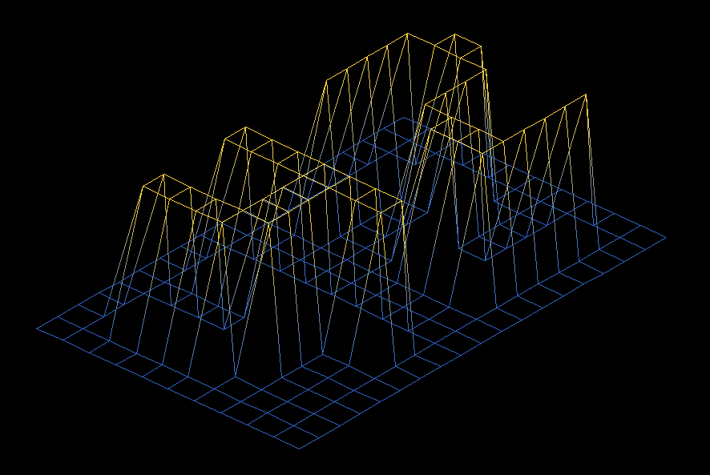
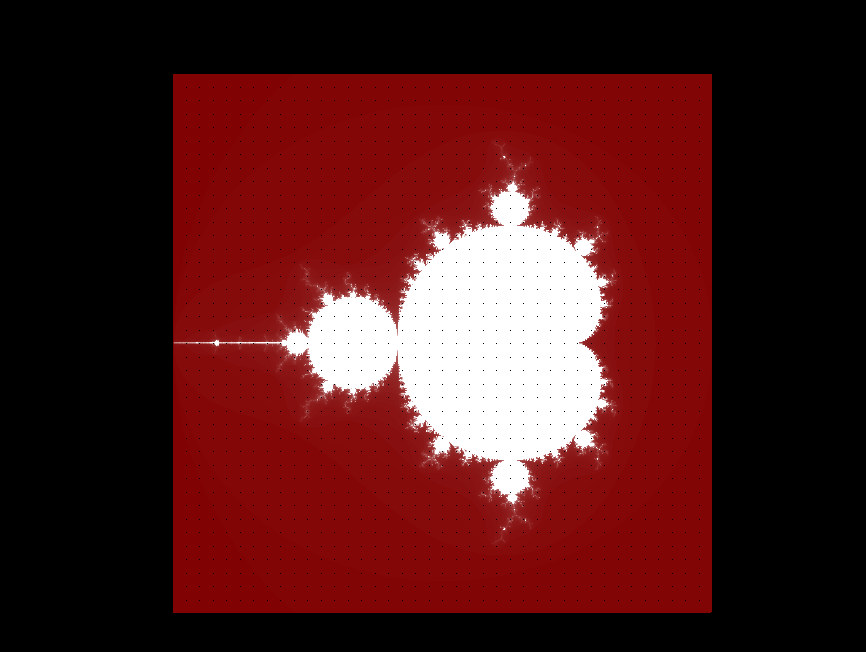
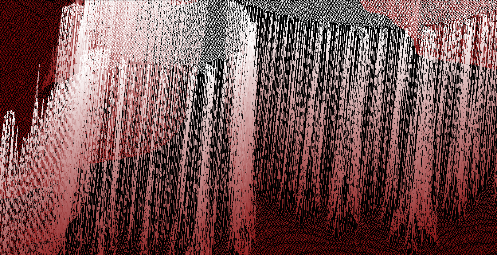
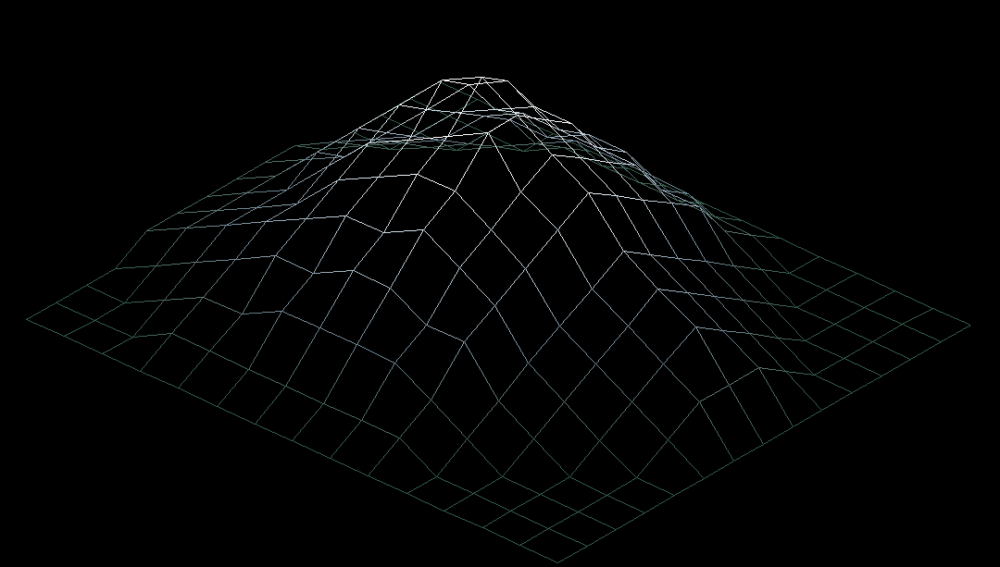
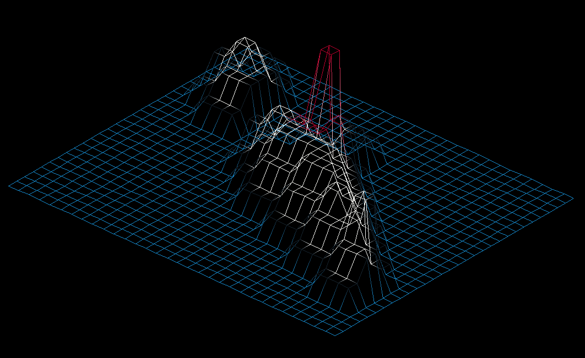
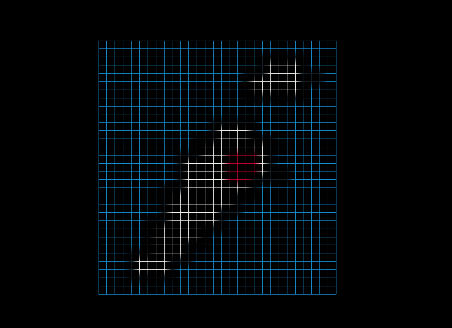

# FdF

*This project has been created as part of the 42 curriculum by lseabra-.*



## Description

FdF (Fil de Fer) is a wireframe terrain viewer written in C. It turns a text
height map into a 3D point grid, projects and rotates that terrain, then draws
it as colored lines in a MiniLibX window.

As a first graphics project in the 42 curriculum, FdF brings low-level C work
into a visible result: parsing a real input format, managing memory, applying
3D transforms, drawing lines pixel by pixel into an image buffer, and
responding to user input. The project reuses `libft`, the personal utility library built in the
first 42 project, instead of replacing that work with convenience routines.

### Technical Highlights

- Parses rectangular `.fdf` grids with optional per-point hexadecimal colors.
- Projects and rotates 3D points with matrix operations.
- Draws horizontal and vertical grid edges into a MiniLibX image buffer.
- Uses Bresenham's integer line-drawing algorithm and interpolates color along
  each segment.
- Includes a bonus viewer with pan, three-axis rotation, zoom, projection
	switching, and independent height scaling.

| Part | Topics | Description |
|---|---|---|
| Mandatory | Map parsing, isometric projection, 3D rotation, line drawing, color interpolation | Loads a height map and displays it as a wireframe terrain. The initial view is isometric. |
| Bonus | Panning, axis rotation, zoom, projection switching, height scaling | Adds interactive controls for moving and changing the map view. |

### Subject Focus

The project implements the subject's central graphics workflow: load a `.fdf`
height grid, map its values to 3D points, connect neighboring points, and show
the result in an isometric MiniLibX window. It uses a MiniLibX image buffer,
handles both `Esc` and the window close button, and frees resources on exit.
The bonus extends the required viewer with interactive pan, rotation, zoom,
projection switching, and height scaling.

The subject also emphasizes C and Norm compliance, compilation with `cc`
using `-Wall -Wextra -Werror`, avoiding global variables, and freeing allocated
resources correctly. These remain important constraints when reviewing or
extending the project.

### Demonstrations

The screenshots below show the same renderer across different maps and views:


*elem-fract.fdf map - orthographic view*


*elem-fract.fdf map - isometric view with zoom*


*Mont Blanc map - isometric view*


*Japan map - isometric view*


*Japan map - orthographic view*

### The `libft` Foundation

`libft` was the first 42 project: implement a useful subset of standard C
library behavior yourself, understand its contracts, and build a reusable
static library. This repository's `libft` includes character checks, string
and memory operations, conversion and allocation helpers, linked-list
utilities, `get_next_line`, and a custom `ft_printf`.

FdF uses those implementations directly for tasks such as splitting map rows,
converting heights and hexadecimal colors, allocating and clearing data, and
reading files line by line. Examples include `ft_split`, `ft_atoi`,
`ft_atoi_base`, `ft_calloc`, `ft_bzero`, `ft_toupper`, and `get_next_line`.
Reimplementing these helpers makes their behavior and trade-offs part of the
project rather than hiding them behind a dependency.

### What Can Be Used

The exact allowed-function list in the FdF subject is the authority for a 42
submission; follow it if it differs from this repository's implementation.
In this project, the application combines:

- Personal `ft_*` implementations from `libft` for common string, memory,
	conversion, and parsing work.
- Low-level operating-system interfaces for file I/O and lifetime management,
	including `open`, `read` (through `get_next_line`), `close`, `write`,
	`malloc`, and `free`.
- The math library for trigonometry and view sizing.
- MiniLibX for window creation, image buffers, event hooks, and presentation;
	X11 key symbols identify keyboard input on Linux.

The point is not to avoid every library: it is to implement the functions the
curriculum asks you to rebuild, and use only the system and graphics APIs
permitted by the assignment for the rest. MiniLibX supplies the windowing
surface; the map parser, transforms, line drawing, and color interpolation
are implemented in this project.

When extending the project, call the required `ft_*` implementation instead
of its standard-library counterpart whenever the subject requires your own
implementation. For example, use `ft_split` for tokenization and
`ft_atoi_base` for hexadecimal conversion rather than adding a dependency for
those jobs. Always check the subject's allowed-function list before using an
API in a 42 submission.

## Instructions

### Requirements

- Linux with an X11 desktop session.
- A C compiler, `make`, and the X11 development libraries required by MiniLibX.
- On Debian or Ubuntu, install the build dependencies with:

```bash
sudo apt update
sudo apt install build-essential make libx11-dev libxext-dev libbsd-dev zlib1g-dev
```

### Build and Run

Build the mandatory program and open a sample map:

```bash
make
./fdf maps/test_maps/42.fdf
```

Build the bonus version and open a map:

```bash
make bonus
./fdf maps/my_maps/mont_blanc.fdf
```

Both targets produce an executable named `fdf`. When switching between the
mandatory and bonus builds, run the target you want; the Makefile uses marker
files to track which version is currently built.

| Command | Action |
|---|---|
| `make` or `make all` | Build the mandatory program. |
| `make bonus` | Build the version with interactive view controls. |
| `make clean` | Remove object files and library build artifacts. |
| `make fclean` | Clean build artifacts and remove the `fdf` executable. |
| `make re` | Fully clean and rebuild the mandatory program. |

### Controls

The mandatory version supports `Esc` to quit; the window close button also
exits the program.

The bonus version adds:

| Keys | Action |
|---|---|
| Arrow keys | Pan the map. |
| `W` / `S` | Rotate around the X axis. |
| `A` / `D` | Rotate around the Y axis. |
| `Q` / `E` | Rotate around the Z axis. |
| `=` / `-` | Zoom in / out. |
| `I` / `O` | Switch to isometric / orthographic projection. |
| `Z` / `X` | Decrease / increase height scaling. |
| `Esc` | Quit. |

Height scaling is separate from zoom: `Z` / `X` changes the multiplier applied
to each point's height, making terrain relief flatter or more pronounced
without changing the source grid's X/Y coordinates.

### Map Format

A map is a whitespace-separated grid of height values. Every row must contain
the same number of points. A point may optionally include a hexadecimal color
after a comma:

```text
0 0 0 0
0 2 4,0xF5F5FF 0
0 0 0 0
```

The number is the point's height. Colors use the form `height,0xRRGGBB`; points
without an explicit color default to white. The `maps/test_maps/` directory
contains test maps, and `maps/my_maps/` contains additional maps.

## Project Structure

| Path | Purpose |
|---|---|
| `main.c` | Mandatory application entry point. |
| `main_bonus.c` | Bonus application entry point. |
| `srcs/` | Map loading, projection, rendering, line drawing, color handling, and mandatory hooks. |
| `srcs_bonus/` | Bonus controls and rendering updates. |
| `includes/` | Shared project types and function declarations. |
| `libft/` | Personal static utility library built in the first 42 project. |
| `minilibx-linux/` | Bundled Linux MiniLibX implementation. |
| `maps/` | Test maps and personal terrain maps. |

## Resources

### Concepts Used

- **C fundamentals and ownership:** structs for points and application state,
	pointers to shared data, heap allocation, checking allocation results, and
	releasing map, image, and window resources on exit or failure.

- **Input parsing:** reading a file line by line, tokenizing whitespace,
	parsing signed heights and optional hexadecimal colors, and rejecting rows
	that do not match the grid width.

- **Height maps and coordinates:** each grid cell starts as an `(x, y, z)`
	point. The row and column indices give the horizontal position; the map's
	integer gives elevation. Neighboring cells form the wireframe grid.

- **Projection and transforms:** scaling grid coordinates to fit the window,
	applying rotations around X/Y/Z with 3×3 matrices, and centering or panning
	the resulting points. Isometric projection tilts the grid to show depth;
	orthographic view removes the initial tilt. The terrain is still drawn onto
	a flat 2D image: the isometric-style view creates the 3D illusion by showing
	several sides at once while keeping parallel edges parallel. Unlike
	perspective drawing, parallel lines do not converge toward a horizon.

- **Drawing lines with Bresenham's algorithm:** a graphics screen is a grid of pixels, but
	a geometric line usually passes between them. Bresenham's algorithm chooses
	the nearest pixel positions using integer arithmetic, avoiding floating
	point slope calculations for every pixel. It first measures the horizontal
	and vertical distances (`dx` and `dy`) and records whether each coordinate
	should step forward or backward. The larger distance is the *major axis*:
	the algorithm advances one pixel along it at each iteration, while an error
	accumulator tracks how far the ideal line has drifted from the selected
	pixels. For an X-major line, this implementation starts the decision value
	at `2*dy - dx`: each X step adds `2*dy`; when the value is nonnegative, the
	line also steps in Y and subtracts `2*dx`. The Y-major case swaps X and Y.
	This keeps the decision integer-only while bounding the accumulated error.
	Signed coordinate steps support lines in every direction. FdF draws each
	point to its right-hand neighbor and the neighbor below, covering the grid
	without drawing duplicate edges. Pixel writes are clipped to image bounds
	and use the buffer's line stride and bytes-per-pixel.

- **Color interpolation:** each endpoint color is unpacked into alpha, red,
	green, and blue channels. A position ratio along the line is used to blend
	each channel between the endpoints, creating a smooth color transition
	instead of a single flat segment color.

- **Image buffers and MiniLibX:** writing pixels into memory, accounting for
	row stride and pixel depth, putting the completed image into a window, and
	reacting to keyboard and window events.

- **Interactive view state:** changing zoom, pan offsets, rotation angles,
	projection mode, or the Z multiplier, then clearing and rendering the frame
	again.

- **Build and linking:** compiling C translation units, creating and linking
	static libraries, and linking MiniLibX with X11 and math dependencies.

### References

- [Medium - FdF 42 : walkthrough](https://medium.com/@amehri_tarik/fdf-42-a-detailed-walkthrough-7184cca317fc)
- [Medium - 42 The Network: FdF (Fil de Fer) Project Roadmap](https://medium.com/@youbihi129/42-the-network-fdf-fil-de-fer-project-roadmap-464be06d6f15) (accessed October 2026).
- [MiniLibX Linux repository](https://github.com/42Paris/minilibx-linux)
- [Harm Smits' MiniLibX Documentation](https://harm-smits.github.io/42docs/libs/minilibx)
- [Isometric Projection - The Engineer's Post](https://www.theengineerspost.com/isometric-projection/)
- [X.Org documentation](https://www.x.org/wiki/)
- [Bresenham's line algorithm](https://en.wikipedia.org/wiki/Bresenham%27s_line_algorithm)
- [J. E. Bresenham - Algorithm for computer control of a digital plotter](https://web.archive.org/web/20080528040104/http://www.research.ibm.com/journal/sj/041/ibmsjIVRIC.pdf)

### AI Usage

AI was used as a support tool to create maps and help debugging compilation problems, structure and proofread this README.

The core renderer and project source code were not generated as part of this documentation work.

## License

The repository's [MIT License](LICENSE) applies to the project's original
work. It does not replace or override the separate [BSD 2-Clause License for
MiniLibX](minilibx-linux/LICENSE); retain MiniLibX's license and notices when
redistributing that bundled library.